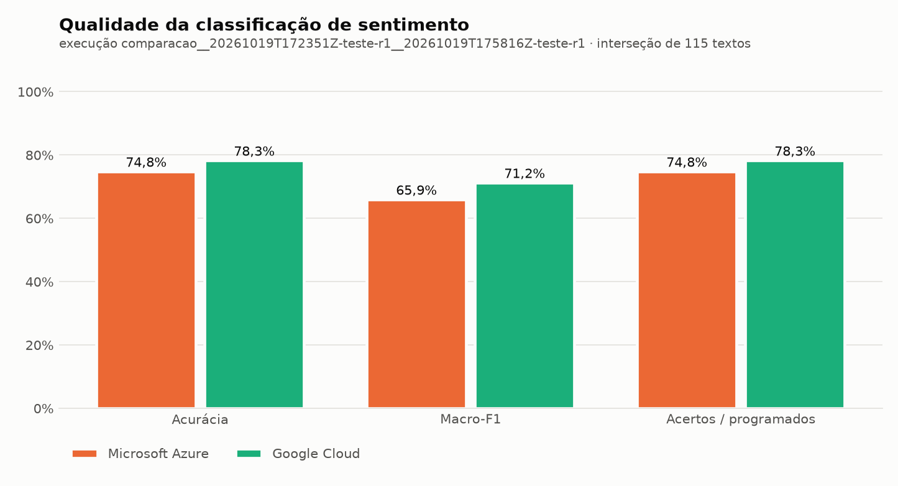
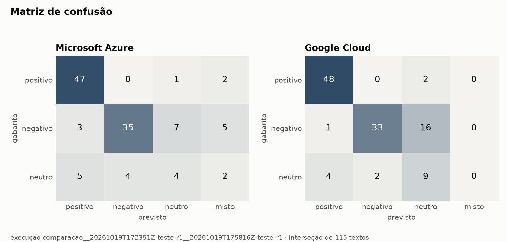
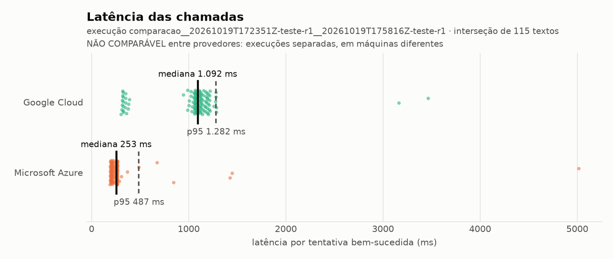

# Comparação de Serviços de Inteligência Artificial em Nuvem

## Etapa 2 — Avaliação Prática

**Disciplina:** Computação em Nuvem — Mestrado em Ciência da Computação, Universidade de Fortaleza (UNIFOR)

**Integrantes:** Davi Fonseca Passos · Rafael Fonseca Pessoa · Lucca Melo Nunes

**Repositório público:** https://github.com/DaviFPassos/Teste_comparativo_nuvem

> **Estado deste documento (19/10/2026): COMPLETO.**
> A coleta foi feita em 19/10/2026 nos dois provedores. As tabelas da seção 6 foram geradas por `etapa2/src/analisar.py` a partir dos arquivos da coleta e **copiadas sem edição**. Só o **custo observado** nos consoles ainda precisa ser conferido (seção 6.3).

---

## 1. Pergunta e escopo

Diante dos **mesmos textos em português**, como a **Azure Language** e a **Cloud Natural Language API** do Google se comparam em **qualidade da classificação de sentimento**, **sucesso das requisições**, **custo** e **latência**?

O enunciado (seção 7) pede avaliar uma ou mais das categorias estudadas, com serviços equivalentes de pelo menos dois provedores. O grupo escolheu **análise de sentimento de documento**, da categoria NLP. Três razões:

- é a operação com equivalente direto nos dois provedores (Etapa 1, `etapa1/nlp.md`);
- é a categoria em que a Etapa 1 encontrou as diferenças de **formato de resposta** mais consequentes: classe pronta na Azure, número contínuo no Google;
- o volume necessário cabe nas franquias gratuitas — orçamento de US$ 0.

A AWS ficou de fora porque o Comprehend exige conta em plano pago, o que conflita com o orçamento.

## 2. Serviços comparados

| Provedor | Serviço | Operação | SDK | Região |
|---|---|---|---|---|
| Microsoft Azure | Azure Language in Foundry Tools | Sentiment analysis, síncrona, 1 documento por chamada, idioma `pt-BR` | `azure-ai-textanalytics` 5.4.0 | East US, tier **F0** |
| Google Cloud | Cloud Natural Language API v1 | `analyzeSentiment`, 1 documento por chamada, idioma `pt` | `google-cloud-language` 2.21.0 | global |

## 3. Dados de teste

*(seção 8 do enunciado — detalhes em `etapa2/dados/README.md`)*

- **Fonte:** B2W-Reviews01 — 132.373 avaliações reais da Americanas.com, de janeiro a maio de 2018, publicadas pela B2W Digital sob CC BY-NC-SA 4.0 (fontes ET2-DADOS-01 e 02).
- **Filtros:** foram retirados textos vazios, todas as cópias de textos duplicados e textos com indício de dado pessoal — código de rastreio dos Correios, números de protocolo ou de nota fiscal. Restaram **124.926** elegíveis. Nenhum campo pessoal do dataset foi copiado. Na leitura, mais **3 textos com o nome do autor** foram excluídos por decisão registrada (`etapa2/dados/exclusoes.csv`).
- **Sorteio:** estratificado por estrelas, com semente fixa — 30 textos de piloto e 300 candidatos ao teste, 60 por estrela. Reprodutível byte a byte.
- **Gabarito:** **dois anotadores** independentes, sem ver as estrelas nem as respostas das APIs. O anotador A é Davi Fonseca Passos, com rótulos **gerados por IA** e adotados por ele; o anotador B é um integrante humano, que não consultou a sugestão. A concordância entre os dois mostra quanto o rótulo da IA se aproxima de uma leitura humana. As divergências são resolvidas por discussão registrada, e a concordância é medida por kappa de Cohen. As estrelas **não** são o gabarito: o próprio artigo do dataset mostra que reduzir a escala de 5 pontos a 3 classes "pode levar a conclusões erradas".
- **Conjunto final:** até 50 textos por classe (positivo, negativo, neutro). Os textos rotulados *misto* formam um conjunto exploratório separado, **antes** de qualquer chamada.

**Resultado da anotação** (fonte: `etapa2/dados/manifesto_conjuntos.json`, gerado por `anotacao.py montar`):

| | Valor |
|---|---|
| Textos anotados pelos dois anotadores | 330 |
| Concordância bruta | 87,0% |
| Kappa de Cohen (A × B) | **0,791** |
| Divergências | 43 — decididas pela regra "prevalece o anotador humano (B)" |
| Excluídos | 2 inválidos e 3 com nome do autor |
| Disponíveis entre os candidatos ao teste | 134 positivos · 107 negativos · **15 neutros** |
| **Conjunto de teste** | **115 textos: 50 positivos, 50 negativos, 15 neutros** |
| Piloto | 30 textos |
| Conjunto exploratório (mistos) | 39 textos |

Das 43 divergências, 27 foram entre positivo/negativo (IA) e misto (Rafael): a IA tendeu a escolher o lado predominante, e o anotador humano marcou misto com mais facilidade. A classe neutra ficou com **15** textos, abaixo da meta de 50; por isso a análise traz também a avaliação sem a classe neutra (seção 4).

## 4. Metodologia e métricas

*(seção 9 do enunciado — protocolo completo em `etapa2/metodologia.md`)*

**Normalização para uma convenção comum** (`positivo`, `negativo`, `neutro`, `misto`):

- **Azure:** tradução direta da classe do serviço, `mixed` → `misto`.
- **Google:** o serviço devolve só um número. `score > +0,25` → positivo; `score < −0,25` → negativo; caso contrário, neutro. O limiar é uma escolha do grupo e pode ser ajustado **apenas com o piloto**.

Uma previsão `misto` conta como erro no plano de três classes.

**Avaliação sem a classe neutra.** Avaliação de produto quase sempre opina, e a classe neutra ficou escassa entre os candidatos. Por isso, **antes da coleta**, o grupo decidiu reportar ao lado da principal a mesma comparação só com os textos de gabarito positivo e negativo: acurácia, macro-F1 das duas classes e McNemar. Uma previsão neutro ou misto continua contando como erro.

**Métricas:**

| Aspecto | Métrica | População |
|---|---|---|
| Qualidade | Acurácia, precisão/revocação/F1 por classe, **macro-F1**, matriz de confusão | Interseção: textos com resposta utilizável nos dois provedores |
| Qualidade, sem esconder falhas | Acertos ÷ todos os textos programados | Todos os textos |
| Diferença entre provedores | **McNemar exato** e kappa entre as previsões | Interseção |
| Sucesso | Por tentativa e por texto | Todas as chamadas |
| Latência | Mediana e p95 (posto mais próximo), sem a chamada de aquecimento | Tentativas bem-sucedidas |
| Custo | Unidades × tarifa, com e sem franquia; e custo observado no painel | Todas as chamadas, incluindo o piloto |

## 5. Programa de teste e condições

*(seções 8 e 10 do enunciado)*

O programa (`etapa2/src/`) envia **um texto por chamada**. Cada tentativa tem timeout de 30 s, e só os erros transitórios são repetidos, até 3 vezes. As **novas tentativas automáticas dos SDKs ficam desligadas** (fontes ET2-SDK-02 e 03). Cada tentativa é registrada, com a resposta original sem identificadores da conta. Uma trava recusa a coleta se o pior caso passar de 90% da franquia gratuita. Há 93 testes offline, que usam os SDKs oficiais com a rede substituída.

**Arranjo de execução:** cada provedor roda no laptop de quem tem a credencial. O Google fica com o Davi e a Azure com o Rafael, sobre o **mesmo** `teste.csv` congelado. A análise junta as duas execuções e só aceita a junção se o dataset for idêntico byte a byte e a regra de normalização for a mesma.

| Condição (seção 10) | Mesma nos dois? |
|---|---|
| Textos, gabarito, normalização, política de tentativas, timeout, versões de SDK, aquecimento | **Sim** |
| Máquina, rede, horário | **Não** — por isso a **latência não é comparada entre provedores**; a de cada um vale isoladamente |

## 6. Resultados

Execuções analisadas, todas sobre os conjuntos congelados em 19/10/2026:

| Conjunto | Google (laptop do Davi) | Azure (laptop do Rafael) |
|---|---|---|
| Piloto (30) | `20261019T171950Z-piloto-r1` | `20261019T174849Z-piloto-r1` |
| **Teste (115)** | `20261019T172351Z-teste-r1` | `20261019T175816Z-teste-r1` |
| Exploratório misto (39) | `20261019T172623Z-exploratorio_misto-r1` | `20261019T175924Z-exploratorio_misto-r1` |

A análise conjunta foi gerada por:

```bash
uv run etapa2/src/analisar.py --execucao 20261019T172351Z-teste-r1 20261019T175816Z-teste-r1
```

e conferiu que as duas execuções usaram o mesmo `teste.csv` (SHA-256 `7591d278…f24f9e`), a mesma regra de normalização e um provedor cada. **Os 115 textos ficaram na interseção** — nenhum foi excluído, porque nenhuma chamada falhou.

**Tabela principal** (copiada sem edição de `etapa2/resultados/comparacoes/comparacao__20261019T172351Z-teste-r1__20261019T175816Z-teste-r1/analise/tabela_principal.md`):

| Provedor | Respostas válidas | Acurácia | Macro-F1 | Acertos / programados | Previsões `misto` | Latência mediana (ms) | Latência p95 (ms) | Sucesso por tentativa | Custo estimado (USD, com franquia) |
|---|---|---|---|---|---|---|---|---|---|
| azure | 115/115 | 74,8% | 65,9% | 74,8% | 9 | 253 | 487 (n=115) | 100,0% | 0.00 |
| google | 115/115 | 78,3% | 71,2% | 78,3% | 0 | 1.092 | 1.282 (n=115) | 100,0% | 0.00 |

**Latência não comparável entre provedores** — execuções separadas em máquinas diferentes: a latência de cada provedor é válida, mas a comparação entre eles não é.

Comparação pareada (115 textos): McNemar exato b=10, c=14, p=0.541; kappa entre provedores = 0.613.

Sem a classe neutra (positivo × negativo, 100 textos da interseção; previsão neutro ou misto conta como erro):

| Provedor | Acurácia | Macro-F1 |
|---|---|---|
| azure | 82,0% | 88,2% |
| google | 81,0% | 88,2% |

McNemar exato sem a classe neutra: b=10, c=9, p=1.000.

### 6.1 Qualidade



**Não há diferença estatisticamente significativa entre os dois serviços.** O Google acertou 3,5 pontos a mais com 3 classes, mas a diferença se apoia em poucos textos: dos 115, a Azure acertou sozinha 10, o Google acertou sozinho 14, os dois erraram 15 e os dois acertaram 76. Com 24 textos discordantes, um placar de 10 × 14 tem p = 0,541 — compatível com acaso. Sem a classe neutra, o placar vira 10 × 9 (p = 1,000).

Os dois **concordam entre si** de forma substancial (kappa 0,613), mas não erram nos mesmos textos — o que importa para a seção 9.



**Por classe** (interseção de 115 textos; fonte: `metricas.json` da comparação):

| Classe (suporte) | Azure — precisão / revocação / F1 | Google — precisão / revocação / F1 |
|---|---|---|
| positivo (50) | 85,5% / 94,0% / 0,895 | 90,6% / 96,0% / 0,932 |
| negativo (50) | 89,7% / 70,0% / 0,787 | 94,3% / 66,0% / 0,776 |
| neutro (15) | 33,3% / 26,7% / 0,296 | 33,3% / 60,0% / 0,429 |

O que a matriz mostra:

- **Positivos são fáceis para os dois** (revocação ≥ 94%). No Google, 39 dos 50 receberam score +0,9.
- **Os dois perdem cerca de um terço dos negativos — por caminhos diferentes.** O Google manda **16 de 50 negativos para `neutro`**, todos com score entre −0,2 e +0,2. São, em boa parte, **reclamações factuais, sem palavra de emoção**: "veio faltando uma peça", "Comprei o produto cinza e Rosa, porém veio preto e vermelho!", "até o exato momento não recebi o produto". A Azure acerta parte desses e espalha os próprios erros: 7 negativos viram `neutro`, 5 viram `misto` e 3 viram `positivo`.
- **Mudar o limiar não resolve o Google.** Baixar a faixa neutra de ±0,25 para ±0,15 recuperaria só os 4 negativos com score −0,2; os outros 12 têm score entre −0,1 e +0,2. É uma característica do serviço, não da regra do grupo.
- **A classe neutra é ruim nos dois** (F1 0,30 e 0,43, com só 15 textos). Esse F1 instável é o que puxa o macro-F1 de 3 classes para baixo — e o motivo da avaliação sem a classe neutra, decidida antes da coleta.
- **A Azure previu `misto` 9 vezes no teste** (5 negativos, 2 positivos, 2 neutros do gabarito). Alguns são textos claramente negativos para um leitor — por exemplo, "Americanas.com = serviço lixo. Primeira e última vez que compro de vocês." — em que bastou uma frase de outro tom para a regra mecânica da Azure compor `mixed` (seção 8).

Na avaliação sem a classe neutra, o macro-F1 (88,2%) fica acima da acurácia (81–82%). Não é erro: uma previsão `neutro` para um texto negativo reduz a revocação do negativo, mas não conta como falso positivo de nenhuma das duas classes avaliadas, então não reduz a precisão.

### 6.2 Sucesso e falhas

| | Azure | Google |
|---|---|---|
| Tentativas (sem aquecimento) | 115 | 115 |
| Sucesso por tentativa | 100% | 100% |
| Sucesso por texto | 115/115 | 115/115 |
| Erros de limite, timeout ou servidor | 0 | 0 |
| Novas tentativas necessárias | 0 | 0 |

O mesmo valeu para o piloto (30/30 nos dois) e para o exploratório (39/39 nos dois). Com envio sequencial e intervalo mínimo entre chamadas, nenhum limite de taxa foi atingido.

### 6.3 Custo — estimado e observado

Os dois serviços cobram em unidades de até 1.000 caracteres, a US$ 1,00 por mil unidades fora da franquia (`custos/premissas.csv`). Nenhum texto do teste passou de 1.000 caracteres: cada texto custou 1 unidade, mais 1 unidade de aquecimento por execução.

| Execução | Azure (unidades) | Google (unidades) |
|---|---|---|
| Piloto | 31 | 31 |
| Teste | 116 | 116 |
| Exploratório | 40 | 40 |
| **Total do experimento** | **187** | **187** |
| Demonstrações gravadas (fora do experimento) | 9 | 16 |
| Franquia mensal | 5.000 | 5.000 |
| **Custo estimado com franquia** | **US$ 0,00** | **US$ 0,00** |
| Custo estimado sem franquia (só o experimento) | US$ 0,19 | US$ 0,19 |

**Custo observado:** a conferir no console de cada provedor (Google: *Faturamento → Relatórios*; Azure: recurso Language → *Métricas* e *Gerenciamento de Custos*). Pelo desenho, o valor esperado é US$ 0,00: a Azure no tier F0 não cobra, e o Google ficou abaixo de 5% da franquia.

### 6.4 Latência — cada provedor isoladamente



| | Azure | Google |
|---|---|---|
| Mediana | 253 ms | 1.092 ms |
| p95 | 487 ms | 1.282 ms |
| Mínimo / máximo | 190 / 5.015 ms | 301 / 3.465 ms |
| Aquecimento (1ª chamada, fora da medida) | 865 ms | 1.646 ms |

**Estes números não se comparam entre si**: cada provedor rodou numa máquina e numa rede diferentes, em horários diferentes (seção 5). Cada um vale isoladamente, como tempo de ida e volta visto pelo cliente, com rede e processamento:

- **Azure:** quase todas as chamadas entre 190 e 300 ms; três passaram de 1 s, uma delas com 5 s.
- **Google:** a distribuição tem **dois grupos** — 20 das 115 chamadas perto de 300 ms e o resto perto de 1,1 s. A causa não foi investigada (pode ser roteamento ou reaproveitamento de conexão); fica registrada como observação.
- Nos dois, a **primeira chamada é mais lenta** (conexão e autenticação), o que confirma a decisão de tirar o aquecimento da medida.

### 6.5 Conjunto exploratório (textos mistos)

Os 39 textos que o gabarito considerou `misto` — elogio e crítica sem predominância — foram enviados aos dois serviços à parte (`etapa2/resultados/comparacoes/comparacao__20261019T172623Z-exploratorio_misto-r1__20261019T175924Z-exploratorio_misto-r1/`):

| Previsão | Azure | Google |
|---|---|---|
| `misto` | **10** (26%) | — (não existe no Google) |
| `neutro` | 0 | **24** (62%) |
| `positivo` | 21 (54%) | 11 (28%) |
| `negativo` | 8 (21%) | 4 (10%) |

- **O Google empurra a ambiguidade para o zero.** Sem classe para texto misto, 62% deles caíram na faixa neutra.
- **A Azure reconhece parte dos mistos** (26%), mas na maioria escolhe um lado — e mais o positivo que o negativo. Somando teste e exploratório, o `mixed` da Azure aparece tanto em textos que um leitor chamaria de mistos quanto em textos claramente negativos: é uma regra de composição de sentenças, não um juízo de predominância.

## 7. Confronto com a Etapa 1

*(seção 10 do enunciado)*

As 13 expectativas foram registradas **antes** da coleta, em `etapa2/expectativas_etapa1.md`, com o modo de verificação de cada uma. A coluna *Conclusão* daquele arquivo traz o veredito completo; o resumo:

| # | O que a Etapa 1 levou a esperar | O que os testes mostraram | Conclusão |
|---|---|---|---|
| E1 | Azure: recurso + endpoint/chave. Google: projeto + API + credencial | A descrição estava certa, mas o Google teve **quatro obstáculos** que a documentação não antecipava (ID × nome do projeto, faturamento obrigatório, login ADC separado, ajuste no WSL). A Azure foi configurada sem obstáculo | **Complementa** |
| E2 | Os exemplos de código representam a chamada real | A chamada é a mesma, mas medir exigiu desligar as novas tentativas dos SDKs, fixar o timeout e guardar a resposta original | **Complementa** |
| E3 | Azure devolve classe + 3 confianças; Google, só um número | Confirmado em 115/115 respostas de cada. O Google deu scores idênticos para as mesmas frases em duas rodadas | **Confirma** |
| E4 | O `mixed` da Azure é composto por sentenças e vai aparecer em textos que o gabarito considera positivos ou negativos | 9 previsões `misto` no teste, 7 delas em textos de gabarito positivo ou negativo — inclusive textos claramente negativos. Frases de sinais opostos escritas como **uma sentença só** não viram `mixed` | **Confirma** |
| E5 | O Google não tem classe para texto ambíguo; mistos caem perto de zero | 24 dos 39 mistos → `neutro`. E mais: **16 dos 50 negativos** também — reclamações factuais recebem score perto de zero | **Confirma e complementa** |
| E6 | O limiar ±0,25 é escolha do grupo, não regra do Google | Mantido após o piloto. No teste, nenhum limiar razoável resolveria os negativos perto de zero | **Confirma** |
| E7 | Só a Azure distingue `pt-BR`; sem promessa de resultado melhor | Não isolável neste desenho; a Azure não foi melhor | **Não testável** (hipótese mantida) |
| E8 | O Google detecta o idioma | `pt` em 115/115 | **Confirma** |
| E9 | Para textos curtos, as duas cobram o mesmo número de unidades | 116 unidades em cada no teste; 187 em cada no experimento | **Confirma** |
| E10 | Dentro da franquia, custo US$ 0 | Estimado US$ 0,00 nos dois; observado a conferir no console | **Confirma** (estimado) |
| E11 | Nenhum erro de limite em envio sequencial | 0 erros nas 374 chamadas do experimento, somando os dois provedores e o aquecimento | **Confirma** |
| E12 | Encerramento anunciado da análise de sentimento da Azure (31/03/2029) | Não testável; segue como risco de manutenção | **Não testável** |
| E13 | A Etapa 1 não afirmou nada sobre latência | Medida: Azure 253 ms e Google 1.092 ms de mediana, em máquinas diferentes — não comparáveis | **Complementa** |

**Em síntese, os testes confirmam a Etapa 1 no que ela disse sobre o formato das respostas e o custo, e a complementam em dois pontos que a documentação não mostra:** o esforço real de configurar o Google e o comportamento do score do Google com reclamações sem emoção explícita. Nenhuma conclusão da Etapa 1 foi contrariada. A Etapa 1 não fez afirmação de qualidade; o empate estatístico medido aqui é informação nova.

## 8. Limitações

- **Um domínio:** avaliações de produtos de um varejista, de 2018. Os resultados não valem para redes sociais, notícias ou atendimento.
- **Textos de 50 caracteres ou mais:** a fonte quase não tem textos menores. Comentários muito curtos não estão representados.
- **A classe neutra é curta:** 15 textos no teste. O F1 do neutro é instável, e a avaliação sem a classe neutra (seção 4) mostra o resultado sem depender dela.
- **Poder estatístico:** com 115 textos e 24 discordantes, o McNemar só detectaria uma diferença grande entre os serviços. O empate medido **não prova** que os dois são iguais; mostra que, nesta amostra, nenhum é claramente melhor.
- **Rótulos do anotador A gerados por IA:** usar IA de linguagem para rotular o gabarito de serviços de IA de linguagem pode aproximar o gabarito do "jeito de máquina" de ler sentimento. O anotador B humano, o kappa (0,791) e a regra de que o anotador humano prevalece nas divergências existem para medir e corrigir isso.
- **Latência não comparável entre provedores:** máquinas e redes diferentes (seção 5).
- **Uma rodada:** as duas demonstrações do Google deram scores idênticos para as mesmas frases, o que sugere resposta determinística. A variação entre rodadas não foi medida.
- **`misto` tem definições diferentes:** no gabarito, é decidido por predominância; na Azure, é composto mecanicamente pelas sentenças. Parte dos "erros" da Azure na coluna `misto` é diferença de definição (seções 6.1 e 6.5).
- **Variante de idioma:** a vantagem de a Azure distinguir `pt-BR` não é isolável neste desenho.

## 9. Conclusões

Para um desenvolvedor que precisa classificar sentimento de avaliações em português, os testes levam a cinco conclusões:

1. **Em qualidade, os dois serviços empatam neste conjunto.** Azure 74,8% e Google 78,3% de acurácia com 3 classes; 82,0% e 81,0% só com positivo e negativo. Nenhuma diferença é estatisticamente significativa. A escolha entre eles deve se apoiar nos outros critérios.
2. **Eles erram de jeitos diferentes, e isso pesa mais que a acurácia.** O Google classifica como neutra uma parte grande das reclamações factuais — o que importa, por exemplo, numa aplicação de triagem de reclamações. A Azure espalha os erros e às vezes declara `mixed` em textos claramente negativos. Quem precisa de "positivo, negativo ou ambíguo" recebe isso pronto da Azure, mas com a definição mecânica dela; quem usa o Google precisa definir o limiar e aceitar que não há classe para ambiguidade.
3. **Nenhum dos dois é confiável para a classe neutra** em avaliações de produto (F1 de 0,30 e 0,43). Uma aplicação que dependa de distinguir "não opinou" de "opinou" precisa de cuidado extra com qualquer um dos dois.
4. **Custo e confiabilidade não diferenciam os dois neste volume.** As duas cobram o mesmo número de unidades, as duas saíram a US$ 0 dentro da franquia, e as duas responderam 100% das chamadas. A diferença está na **garantia de custo**: o F0 da Azure recusa chamadas quando a cota acaba; o Google exige conta de faturamento e uma trava do lado da aplicação.
5. **A integração difere mais do que a documentação sugere.** A Azure foi configurada sem obstáculo; o Google exigiu quatro passos não documentados nos exemplos. Do lado do código, os dois SDKs repetem chamadas sozinhos por padrão — o do Google por até 600 s —, e quem precisa medir ou controlar latência tem de desligar isso.

Como na Etapa 1, não há um "melhor" absoluto: a **Azure** atende melhor quem quer classe pronta, configuração simples e teto de custo garantido; o **Google**, quem quer um score contínuo para definir o próprio corte. Fica de risco o encerramento anunciado da análise de sentimento da Azure em 2029 (E12).

## 10. Reprodução

```bash
uv run etapa2/rodar_testes.py                                  # 93 testes offline, sem custo
uv run etapa2/src/analisar.py --execucao 20261019T172351Z-teste-r1 20261019T175816Z-teste-r1   # recalcula tudo, sem chamar API
```

Nova coleta (exige credenciais e gera custo dentro da franquia): ver `etapa2/COMO_EXECUTAR.md`.

## Referências

Fontes com URL, data de acesso e afirmação sustentada: `referencias/fontes.md`, seção "Etapa 2 — avaliação prática" (`ET2-*`), além de `NLP-AZ-04`, `NLP-GC-01`, `NLP-GC-03` e `PRE-*`.
